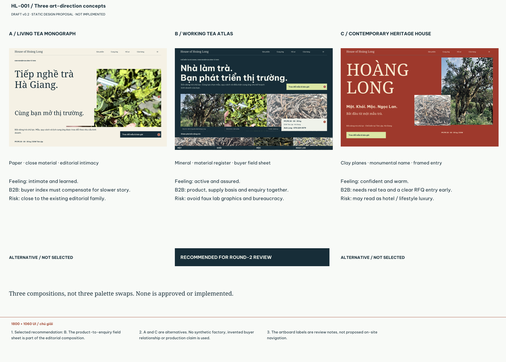
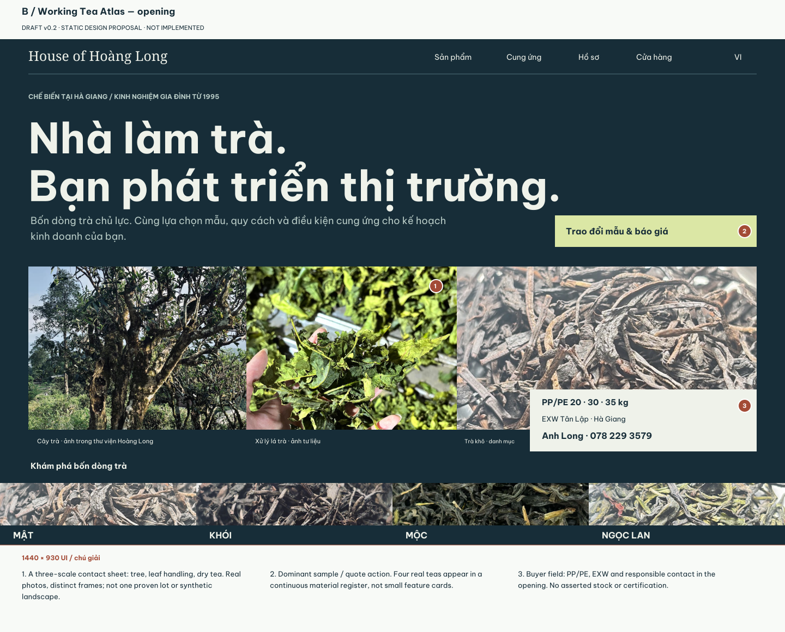
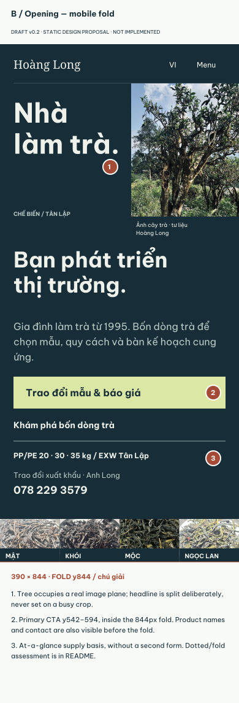

# HL-001 — Round 2 visual concepts

**DRAFT v0.2 · 26 October 2026 · NOT APPROVED · STATIC DESIGN PROPOSALS.**

These are native vector design compositions and PNG exports using existing real
Hoàng Long photographs. They are **not screenshots of a finished website**, an
interactive prototype, application redesign code or a public deployment. The
application source remains unchanged. Rust numbered pins and annotation margins
are review markup, not proposed on-site badges. Text is outlined in the editable,
self-contained SVGs so the reader need not install the fonts.

## Start here: three different directions

**B — Working Tea Atlas is recommended, not approved.** A is a book-spread
alternative; C is a more architectural, brand-led House. Read the commercial,
emotional and execution tradeoffs in [creative direction](../../creative-direction.md).
The three studies differ in composition, not just colour. A and B have full
responsive opening studies; C is deliberately a comparison study only.

The final B opening uses a full-width two-line proposition above three different
physical image scales—tree, handling, dry leaf—rather than retaining the baseline
left-copy/right-tree split. The contact/supply field attaches to the last frame.
The product register connects this opening with the selected-product field sheet.
The sequence and decision utility, not the navy/leaf palette alone, are the design
proposal. Adjacent photographs are an editorial contact sheet, not a single lot
or asserted manufacturing sequence.

## Selected opening and the 390px fold

[Desktop full size](b-opening-1440.png) · [Mobile full size](b-opening-390.png) ·
[Desktop SVG](b-opening-1440.svg) · [Mobile SVG](b-opening-390.svg).

UI coordinates exclude the 72px review header above each composition and the
annotation footer below it. The rust line immediately below the mobile UI marks
**y844**, labelled FOLD. At 390×844, the primary CTA occupies x22/y542/w346/h52;
its bottom is594, leaving250px before the fold. The sourcing sentence, trade
basis, contact and four abbreviated tea names also fit. This is a static fold
assessment at the drawn font size, **not** runtime reflow/zoom validation.
A's alternative CTA y710–762 also fits, with weaker immediate product/contact utility.

English opening: [1440](b-opening-en-1440.png) / [390](b-opening-en-390.png).
Headline, support, navigation, kicker and archive captions are independently set
in English; canonical Vietnamese tea names retain identity. Full runtime VI/EN
behavior still requires later implementation QA.

## Four high-fidelity chapter compositions

| Chapter / state | 1440px wide | 390px wide | What to inspect |
| --- | --- | --- | --- |
| Opening | [PNG](b-opening-1440.png) / [SVG](b-opening-1440.svg) | [PNG](b-opening-390.png) / [SVG](b-opening-390.svg) | Two-line cover, three-scale image spread, attached supply/contact field; recomposed mobile tree/producer frame. |
| Craft | [PNG](b-craft-1440.png) / [SVG](b-craft-1440.svg) | [PNG](b-craft-390.png) / [SVG](b-craft-390.svg) | Real handling photograph, material seam and a literal caption; no false portrait. |
| Four teas / Mật selected | [PNG](b-four-teas-1440.png) / [SVG](b-four-teas-1440.svg) | [PNG](b-four-teas-390.png) / [SVG](b-four-teas-390.svg) | Large tea photograph plus notes, qualified trial application, PP/PE/EXW and exact sample action. |
| Industrial evidence | [PNG](b-industrial-1440.png) / [SVG](b-industrial-1440.svg) | [PNG](b-industrial-390.png) / [SVG](b-industrial-390.svg) | Equipment collage intact; declared-capacity qualifier next to the figure, not a ready-stock assertion. |

[Product selector states](selector-states.png): Mật default, Khói selected and an
**enlarged study of the mobile Ngọc Lan selection**. Its three columns are not
claimed to be three390px viewports; use the actual390px product plate for sizing.
Selected controls use a geometric dot, label and ink fill. Future focus must be
a separate visible state. Static buttons do not submit anything.

Alternative A: [1440 PNG](a-opening-1440.png) / [390 PNG](a-opening-390.png),
[1440 SVG](a-opening-1440.svg) / [390 SVG](a-opening-390.svg). Text has an opaque
paper plane; it is not left over a busy photograph.

768px recompositions are specified per chapter in [the storyboard](../../homepage-storyboard.md).
No768px comp or live responsive test is claimed. After authorization, the actual
app must be checked at390/768/1440,320px,200% zoom and reduced motion.

## Original material and portability

| Photo | Existing source | Treatment in the composition |
| --- | --- | --- |
| Tree | `public/landing/1.jpg` | Honest crop inside an image plane; archive caption. No invented landscape, age or geolocation. |
| Handled leaves | `public/landing/2.jpg` | Real hand/material close-up. Not a named portrait or a new task claim. |
| Equipment | `public/landing/3.jpg` | Complete existing two-photo collage; no synthetic factory panorama. |
| Four dry teas | `public/export/core-*.jpeg` | Original photo pixels, layout crops only. Catalog identity, not a grade/lot promise. |

No generated photography, new source images, external brand assets or customer
records are introduced. The SVG image data embeds the original JPEGs, unmodified;
the PNG is a raster export of that vector layout. The existing product-photo
provenance remains in `public/export/README.md`. Font studies use Be Vietnam Pro
and Noto Serif from the source references in [visual system](../../visual-system.md);
no production font/dependency change. Source SVGs preserve composition/crop data
and outlined typography; there is no app route or serving requirement to review them.

## Scope and known limits

Four required main chapters and the alternative opening are rendered, not an entire
interactive homepage. Trade-process/contact, supporting retail and footer behavior
are specified, but do not yet have full-page visual execution. The existing
wordmark/seal, submenu destinations and auth/data logic must remain in a later
implementation; simple brand/nav labels on these studies are not new artwork or
permission to remove current destinations.

These studies do not establish actual cupping results, product availability,
factory audit, mobile browser behavior, keyboard/ARIA, image performance or
conversion outcomes. Review the [Release A/B photo plan](../../photographic-readiness.md),
[artifact verification](artifact-verification.json) and [R1–R9 response](../../round-2-response.md).
PNG/SVG checksums are in [checksums.json](checksums.json); sizes and source IDs in
[manifest.json](manifest.json). Creative Director approval remains pending.
